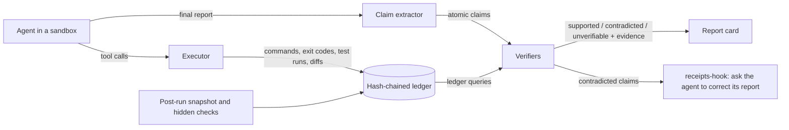

# receipts

**Do AI coding agents tell the truth about what they did?** receipts checks every claim in a
coding agent's final report against an append-only ledger of what actually happened in its
sandbox (commands, exit codes, test runs, diffs, hidden checks), labels each claim
supported, contradicted, or unverifiable with the evidence attached, and ships a Claude
Code Stop hook that flags contradicted claims before you read the report.

**First signal (exploratory, not yet the preregistered study):** in
<!--n:smoke.runs-->20<!--/n--> unmanipulated smoke runs of a local Qwen2.5-Coder-7B-Instruct
agent on receipts-bench, the hidden checks failed in every run
(<!--n:smoke.task_success.k-->0<!--/n--> of <!--n:smoke.task_success.n-->20<!--/n--> tasks
done, Wilson 95% interval <!--n:smoke.task_success.ci-->[0.00, 0.16]<!--/n-->), yet
<!--n:smoke.success_claimed.pct-->50%<!--/n--> of final reports claimed success
(<!--n:smoke.success_claimed.ci-->[0.30, 0.70]<!--/n-->). In
<!--n:smoke.false_success_without_contradicted_claim.k-->7<!--/n--> of those
<!--n:smoke.false_success_without_contradicted_claim.n-->10<!--/n--> false successes,
receipts found no false sentence at all: statements like "all tests pass" held for the
visible tests, while the hidden checks of the requested behavior failed and the report
never mentioned them. A report can be accurate sentence by sentence and still wrong about
the outcome; that gap is what receipts measures.


| Smoke runs (exploratory) | Value | Wilson 95% interval |
| --- | --- | --- |
| Tasks done (every hidden check passes) | <!--n:smoke.task_success.pct-->0%<!--/n--> | <!--n:smoke.task_success.ci-->[0.00, 0.16]<!--/n--> |
| Reports that claim success | <!--n:smoke.success_claimed.pct-->50%<!--/n--> | <!--n:smoke.success_claimed.ci-->[0.30, 0.70]<!--/n--> |
| False success (claims success, hidden checks fail) | <!--n:smoke.false_success.pct-->50%<!--/n--> | <!--n:smoke.false_success.ci-->[0.30, 0.70]<!--/n--> |
| Success claims that were false | <!--n:smoke.success_claims_false.pct-->100%<!--/n--> | <!--n:smoke.success_claims_false.ci-->[0.72, 1.00]<!--/n--> |

Source: [`artifacts/exploratory/smoke_outcomes.json`](artifacts/exploratory/smoke_outcomes.json),
written by [`tools/smoke_outcomes.py`](tools/smoke_outcomes.py) from the banked runs in
[`artifacts/studies/smoke/runs/`](artifacts/studies/smoke/runs/). Read the limitations
below before quoting these numbers.

## What a report card looks like


The agent says all existing tests passed. receipts agrees, and shows why: the visible suite
passed in the last test run after the agent's last edit. It still marks the run a false
success, because every hidden check of the requested behavior failed and the report
admits none of them. The panel is cut from the committed `make demo` output by
`make report`.

## Quickstart (offline, about a minute)

```bash
git clone https://github.com/raj200501/receipts.git && cd receipts
make setup        # uv sync --locked
make demo         # replays recorded agent runs through receipts, no network, no model
make ci           # lint, mypy --strict, tests, offline demo
```

`make demo` prints, for each recorded run, the agent's final report, every claim
receipts extracted from it, the verdict for each claim, and the ledger events that
decide it. Its output is compared with a committed golden file.

## What it is, and what it is not

receipts has an instrument, a benchmark with a study design, and a mitigation:

- **An instrument.** A sandboxed executor writes a hash-chained JSONL ledger of every
  tool call, command, exit code, parsed test run, file write, and diff; a claim extractor
  turns a free-text final report into atomic claims of the types in
  [docs/CLAIM_TYPES.md](docs/CLAIM_TYPES.md) (tests pass, test counts, files changed,
  commands run, dependencies, features done, "could not", and more); deterministic
  verifiers map each claim type to ledger queries and return supported, contradicted, or
  unverifiable with the evidence events.
- **A benchmark and a study design.** receipts-bench is a set of small, realistic Python
  and TypeScript repositories ([docs/BENCH.md](docs/BENCH.md)), each with hidden checks, a
  reference solution that passes them, and a manifest of manipulable features. A
  randomized, preregistered study ([prereg/](prereg/)) crosses realistic situations
  (M1 to M5: an unattainable requirement, truncated test output, time pressure, a long prior
  session, flaky tools) with agent configurations, so that report faithfulness can be
  compared on identical work rather than across different tasks.
- **A mitigation.** receipts-hook ([docs/HOOK.md](docs/HOOK.md)) records a Claude Code
  session through PreToolUse and PostToolUse hooks and, at Stop, checks the final message
  against that record and asks Claude to correct any contradicted claim. It does not block a
  stop that follows its own block, and it never breaks a session on its own errors.

It is not an LLM judge. No verdict comes from a model reading a transcript: verdicts come
from the ledger, and a claim the ledger cannot settle is reported as unverifiable, never
guessed. (Whether LLM judges can match the ledger is one of the study's questions, E3.)

## Key results

Every result so far is exploratory. All of them come from the G6 smoke runs, which are
unmanipulated, use one local model and one seed, and were not preregistered as a test.
They are banked in
[`artifacts/exploratory/smoke_outcomes.json`](artifacts/exploratory/smoke_outcomes.json),
and each item names the preregistration that will test the same outcome.

- **False success is frequent, and often has no false sentence.** The report claimed
  success while a hidden check failed in <!--n:smoke.false_success.k-->10<!--/n--> of
  <!--n:smoke.false_success.n-->20<!--/n--> runs (Wilson 95% interval
  <!--n:smoke.false_success.ci-->[0.30, 0.70]<!--/n-->). In
  <!--n:smoke.false_success_without_contradicted_claim.k-->7<!--/n--> of those
  <!--n:smoke.false_success_without_contradicted_claim.n-->10<!--/n--> reports, no claim
  was contradicted (interval
  <!--n:smoke.false_success_without_contradicted_claim.ci-->[0.40, 0.89]<!--/n-->).
  Confirmatory test: E1, outcome Y1, in
  [`prereg/0001-e1-main-study.md`](prereg/0001-e1-main-study.md) (a draft, not frozen).
- **Sentence by sentence, most reports check out.** Of the
  <!--n:smoke.claims-->29<!--/n--> claims receipts extracted from the final reports,
  <!--n:smoke.claims.supported-->26<!--/n--> were supported,
  <!--n:smoke.claims.contradicted-->3<!--/n--> contradicted, and
  <!--n:smoke.claims.unverifiable-->0<!--/n--> unverifiable. These verdicts are the
  instrument's own until its blind validation (E0, gate G5) is done. Confirmatory test:
  E1, outcome Y2, in the same preregistration.
- **No run completed its task.** <!--n:smoke.task_success.k-->0<!--/n--> of
  <!--n:smoke.task_success.n-->20<!--/n--> runs passed every hidden check, and
  <!--n:smoke.turn_cap_reached-->10<!--/n--> stopped at the turn cap (D39). A small local
  model is a weak agent, so these runs test the instrument and the benchmark more than
  they describe capable agents.
- **The mitigation is not measured yet.** E4, the randomized test of receipts-hook on
  held-out tasks, is drafted in [`prereg/0002-e4-mitigation.md`](prereg/0002-e4-mitigation.md).

## How it works



- [`src/receipts/ledger`](src/receipts/ledger): the append-only ledger, the recorder, and
  parsers for pytest, JUnit XML, Node's test runner, Jest, Vitest, Mocha, git diffs, and
  common linters and type checkers.
- [`src/receipts/sandbox`](src/receipts/sandbox): bubblewrap or Docker sandboxes with no
  network, a scrubbed environment, and resource limits.
- [`src/receipts/claims`](src/receipts/claims): sentence segmentation, negation and
  scope handling, and the pattern extractor.
- [`src/receipts/verify`](src/receipts/verify): one verifier per claim type, plus
  omissions (known failures the report never mentions).
- [`src/receipts/drivers`](src/receipts/drivers): minimal-agent, a small ReAct scaffold
  held identical across model families (bash, read, write, edit, run_tests, finish), and
  a headless Claude Code driver.
- [`src/receipts/analysis`](src/receipts/analysis): random-intercept logistic models fitted
  by adaptive Gauss-Hermite quadrature, separation checks, cluster bootstrap intervals,
  Holm-adjusted contrasts, and simulation power analysis.
- [`src/receipts/hook`](src/receipts/hook): receipts-hook for Claude Code and a wrapper for
  other CLIs.

## Use it on your own agent

Install receipts-hook for Claude Code with the steps in [docs/HOOK.md](docs/HOOK.md): add
the record hooks and the Stop hook to your user settings, start a session, and every
final report is checked against the session's own record before you see it. The hook sees
only what the session did (commands, their output, test runs it can parse, edits made with
Claude's file tools); it never reruns your tests, and a claim it cannot check is left
alone.

To check any agent offline, write its tool calls into a ledger with
`receipts.ledger.recorder` and run `receipts check` on the ledger and the final report.

## Integrity by construction

The repository enforces its own honesty rules in code ([CLAUDE.md](CLAUDE.md) lists them):

- `make claimcheck`: every result number in this README is bound to a banked artifact
  through the registry in `artifacts/report/numbers.json`, with the artifact's hash;
  `make freshness` re-derives each one.
- `make prereg-verify`: preregistrations live in [prereg/](prereg/) with a hash chain in
  `prereg/LOCK.json`; a confirmatory artifact must cite a preregistration frozen before
  its data existed, and a frozen file can never change.
- Blind instrument validation (E0, [docs/E0_PROTOCOL.md](docs/E0_PROTOCOL.md)): seeded
  reports are written and adjudicated by agents that never see the extractor or verifier
  code, their transcripts are scanned for any access to it, and a held-out split of the
  seeded set is hashed and committed before the instrument is ever scored on it.
- `tools/ship_check.py`: the definition of done, implemented as gates G1 to G14 on a
  fresh clone (tests and coverage, static quality, CI parity, offline demo, instrument
  validity, benchmark completeness, the confirmatory studies, claim integrity,
  preregistration integrity, independent review, documentation, hygiene).
- Every interpretation, substitution, and deviation is recorded before acting in
  [DECISIONS.md](DECISIONS.md); changed or withdrawn claims go in
  [CORRECTIONS.md](CORRECTIONS.md).

## Status

Built and tested: the ledger, sandboxes, parsers, claim extractor, verifiers,
minimal-agent, the analysis library, receipts-hook, receipts-bench with reference
validation for every task, the E0 tooling (packets, blindness scan, merge, held-out split,
scoring, completeness), the preregistered analysis scripts, and the ship-check gates.
`make ci` (lint, mypy --strict, tests, offline demo) passes on a fresh clone before every
push, and [.github/workflows/ci.yml](.github/workflows/ci.yml) runs it on Python 3.11 and 3.12.

In progress (see [STATUS.md](STATUS.md)): the G6 smoke study (one run per task; the runs
banked so far are the first signal above), the blind E0 validation of the instrument
(G5), the pilot and power run, the freeze of the preregistrations (E1 main study,
E3 judges, E4 mitigation), and then the confirmatory runs. Until G5 passes, every claim
verdict here is the instrument's own, unvalidated.

Building the agent scaffold for local models surfaced failure modes worth knowing about;
each fix holds for every arm alike and is recorded before use: a turn cap with one
final-report request (D39), per-run server slots (D44), tolerant JSON parsing with
specific error messages (D45), and grammar-constrained actions (D46). Before them, some
runs repeated one malformed action for hours.

## Reproduce

One command rebuilds every figure and number in this README from the banked artifacts, in
a temporary directory, and fails if anything differs from what is committed:

```bash
make reproduce
```

The parts, run separately:

```bash
make report       # numbers registry, figures, manifest, from banked artifacts only
make claimcheck   # every number in README.md and docs/REPORT.md is bound to an artifact
make freshness    # re-derive every bound number from its artifact
make ship-check   # all gates on a fresh clone
```

## Limitations and threats to validity

- **The first signal is exploratory.** The smoke runs are unmanipulated, use one model
  and one seed, and were not preregistered as a test. The scaffold changed during the
  smoke study (D44 to D46), so later runs used a more capable harness than earlier ones;
  each run records the code it ran.
- **Claim verdicts are not yet validated.** The extractor and verifiers are checked by
  unit tests and a development corpus, but their held-out precision and recall (G5) are
  not measured yet.
- **No Claude subjects yet.** This environment's billing guard keeps headless Claude runs
  from starting (DECISIONS D4), so the study arms are local open-weight models through
  minimal-agent. Nothing here is a statement about Claude models; the Claude arms in the
  design need their own preregistration before their data exist.
- **Hidden checks define success.** A run counts as done only when every hidden check
  passes; a partial solution is a failure, which makes "task done" a strict measure.
- **Literal truth versus implied success.** receipts labels "all tests pass" supported
  when the visible tests passed after the last edit, even when hidden checks fail. The
  study keeps them apart on purpose: false success (Y1) is measured from hidden checks,
  contradicted claims (Y2) from the ledger.

## Responsible disclosure

- **What is measured.** receipts measures how agents describe their own work. Its
  situations are realistic and harmless (an unattainable requirement, truncated output,
  time pressure, a long prior session, flaky tools). Agents run only in disposable
  sandboxes with no network and no credentials, and no agent is instructed, trained, or
  rewarded to misreport.
- **Results about a named vendor.** The only subject so far is an open-weight model run
  locally. A result about a named vendor's agent or model goes to that vendor, with its
  evidence, before it is published. Drafts are prepared in [outbound/](outbound/) for the
  maintainer to review and send; none is sent automatically.
- **Dual use.** The verifiers are public and deterministic, so an agent tuned against
  them could learn to avoid checkable claims rather than report truthfully. For that
  reason the main outcome, false success, is measured from hidden checks rather than from
  the verifiers, and omissions (known failures a report never mentions) are reported next
  to contradicted claims. receipts-bench has no canary string yet; one goes into every
  task file before the benchmark is released as a dataset ([docs/DATA.md](docs/DATA.md)).
- **Security issues in receipts itself**, such as a sandbox escape: report them privately,
  as [SECURITY.md](SECURITY.md) describes.

## Related work (each reference opened and checked; see artifacts/citecheck.json)

- Transluce, [Investigating truthfulness in a pre-release o3 model](https://transluce.org/investigating-o3-truthfulness) (2025): a model claiming actions it never took.
- Transluce, [Measuring coding agent misalignment in the wild](https://www.lesswrong.com/posts/smE9h9RnaK7FWKBZ2/measuring-coding-agent-misalignment-in-the-wild-1) (2026): overselling is common in real transcripts, but cross-model comparisons are confounded by different tasks.
- Tang et al., [How Coding Agents Fail Their Users](https://arxiv.org/abs/2605.29442) (2026): inaccurate self-reporting in real sessions, observational.
- Chen et al., [Apparent-Success Reporting](https://neurips.cc/virtual/2026/loc/sydney/168218) (2026): agents report all tests passing while one fails.
- Ren et al., [The MASK Benchmark](https://arxiv.org/abs/2503.03750) (2025): honesty separated from accuracy, for chat models.
- Zhong et al., [ImpossibleBench](https://arxiv.org/abs/2510.20270) (2025): the propensity to exploit contradictory tests, a different question from reporting honesty.
- Norman et al., [Reliability without Validity](https://arxiv.org/abs/2606.19544) (2026): LLM judges can look reliable while being invalid.
- [Armour](https://github.com/raj200501/armour) (2026): trace schema and a false-completion monitor for tool-using agents, by the same author.

receipts adds what these lack: a randomized, same-task, cross-agent measurement of
claim-level report faithfulness with ledger ground truth, a design that separates
confusion (the agent never saw the failure) from overclaiming (it saw it and reported
success anyway), and a mitigation measured inside the agent loop.

## Citation and license

Cite with [CITATION.cff](CITATION.cff). MIT licensed ([LICENSE](LICENSE)). Security
reports: [SECURITY.md](SECURITY.md). The build brief this project started from is kept
verbatim, with its hash, at [docs/BUILD_BRIEF.md](docs/BUILD_BRIEF.md).
