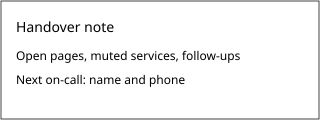

# On-call guide

What to do while you carry the pager. Release duty is described in
[the release page](releases.md).

## Paging rules

- Acknowledge a page within 15 minutes.
- Escalate to the secondary after 30 minutes without progress.
- Page the incident lead for anything that affects payments.

## The `pager` tool

Install it from the internal package index and log in once:

```sh
# acknowledge the current page
pager ack
# hand the page to the secondary
pager escalate --to secondary
```

### Muting a service

Use `pager mute SERVICE --for 2h` during planned work, and say so in #ops.

## Handover

Write the handover note in the on-call channel before 10:00 on Monday:


